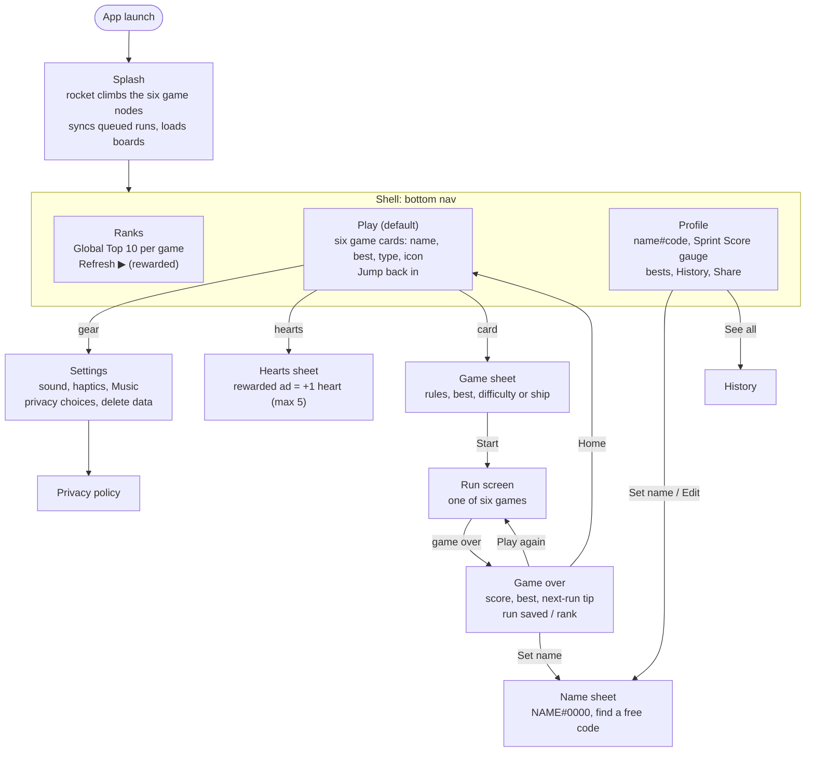
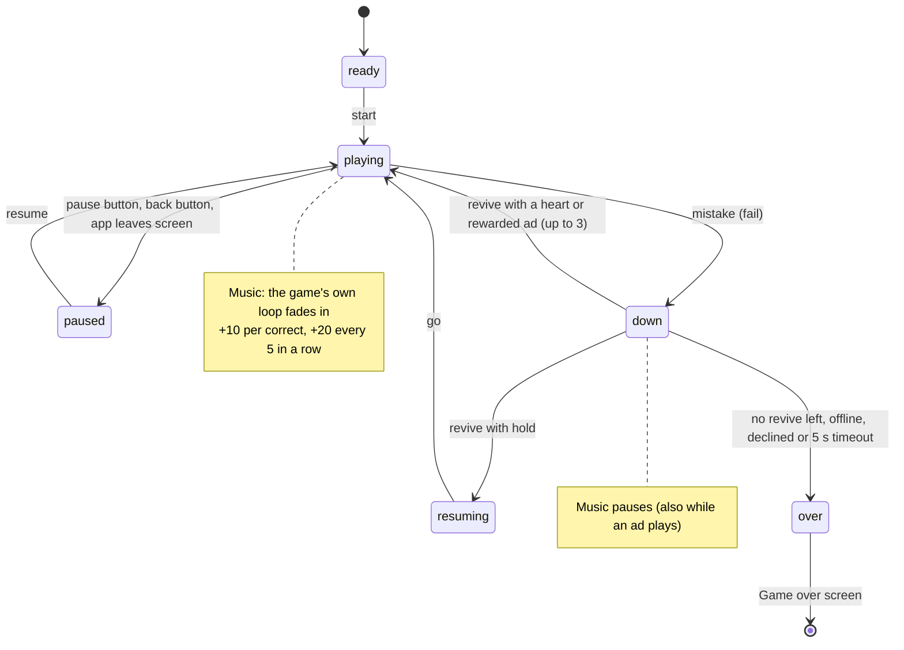
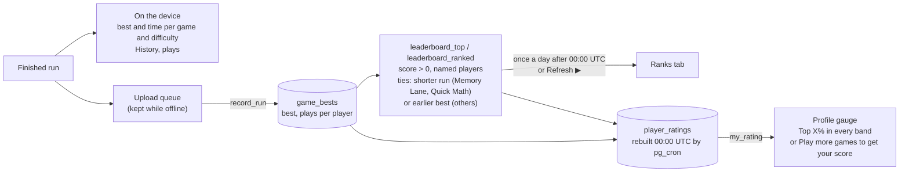

# App flow (1.1)

How LogicSprint fits together, drawn from the code. GitHub renders the Mermaid charts. Update them when a screen, a run state or the scoring changes.

## 1. Screens and navigation

## 2. A run

Every game is a `RoundEngine` (`lib/games/round_engine.dart`) hosted by `RoundScreen`. Music follows the state: it plays only while the run is live.

## 3. Scores, boards and the Sprint Score

Sprint Score maths (same in `supabase/schema.sql` and `lib/models/sprint_rating.dart`):

1. Per board with 30+ players scoring above 0, your percentile, ordered like the board so equal scores get their own place. Easy is capped at 90 and Medium at 97 for the games with levels.
2. Per game you've played 3+ times, your best board.
3. R = (sum of game percentiles + 2 × 50) ÷ (games + 2).
4. Rating = R's percentile among players rated in 2+ games; shown as Top 1, 2, 5, 10, 15, 20, 25, then tens to 100, once 50+ players are rated.

## 4. Release

```mermaid
flowchart LR
    Code["Branch, make check"] --> Shots["Store screenshots<br/>integration_test/store_shots_test.dart<br/>framed in the launch kit"]
    Shots --> Docs["Listing copy, release notes,<br/>README, this file"]
    Docs --> DB["supabase/schema.sql<br/>applied to the live project"]
    DB --> Build["make build-aab / make build-ios"]
    Build --> Upload["Play Console, App Store Connect"]
    Upload --> Review["Review, manual release"]
    Review --> Site["logicsprint.trueorfalse.dev<br/>merge the site branch"]
```

